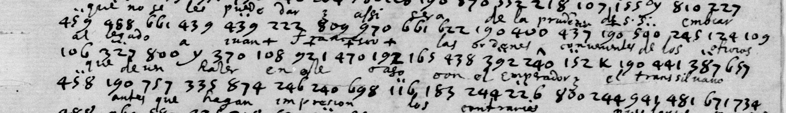

# Français 23054 — Spanish numerical correspondence: excerpt

George Lasry, report PDF `22_francais-23054-spanish-numerical-correspondence.pdf`, "Excerpt and Translation".

## Excerpt 1 (f145r, full cipher lines 6–8)

**…que no se les puede dar, y assi sera de la prudencia de S.S. embiar al legado y a Juan Francisco las ordenes convenientes de los socorros que deven hazer en este año con el Emperador y el transilva**[no]**.**
