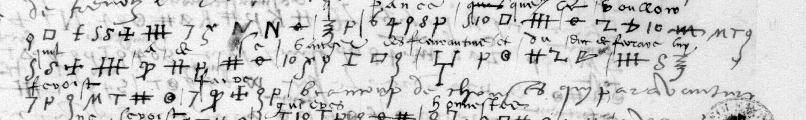

# Français 2999 — Turenne, ff13r–13v: excerpt

George Lasry, report PDF `55_francais-2999-turenne-ff13r13v.pdf`, "Excerpt and Translation".

## Excerpt 1 (f13r, three complete consecutive rows2–4)

**ne qu’il face, ie pance que le vouloir qu’il a de se vanger** des **Florentins et du duc de Ferrare lui feroist faire** beaucoup de choses qui par advanture
