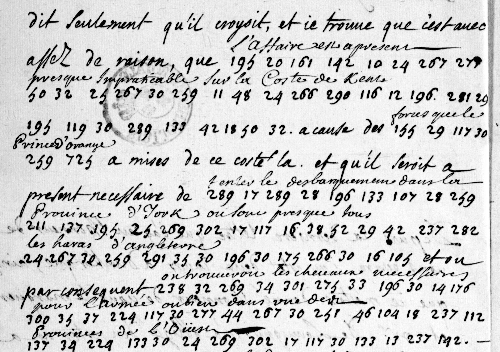

# Clairambault 1108: excerpt

George Lasry, report PDF `26_clairambault-1108.pdf`, "Excerpt and Translation".

## Excerpt 1 (f249v)

…dit seulement qu’il croyoit, et je trouve que c’est avec assez de raison, que **l’affaire est à present presque impraticable sur la coste de Kent**, à cause des **forces que le Prince d’Orange** a mises de ce costé-là. Et qu’il seroit à present necessaire de **tenter le debarquement dans la province d’York, où sont presque tous les haras d’Angleterre**, et où par consequent **on trouveroit les chevaux necessaires pour l’armée, ou bien dans une des provinces de l’Ouest**.
