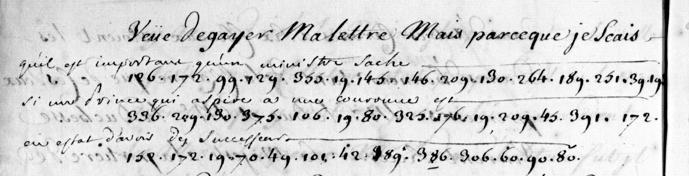

# Clairambault 531 — testament and Holstein marriage: excerpt

George Lasry, report PDF `52_clairambault-531-testament-and-holstein-marriage.pdf`, "Excerpt and Translation".

## Excerpt 1 (p124)

Veue d’egayer ma lettre, mais parce que je sçais **qu’il est important qu’un ministre sache si un prince qui aspire à une couronne est en estat d’avoir des successeurs**.
