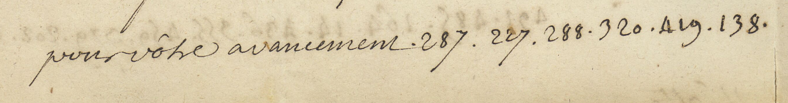
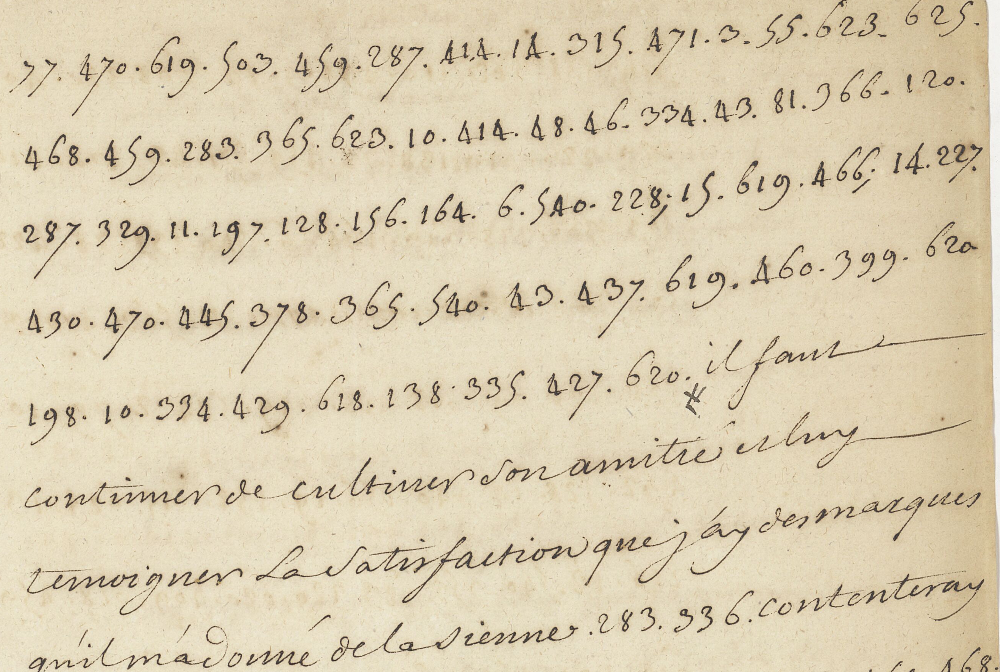
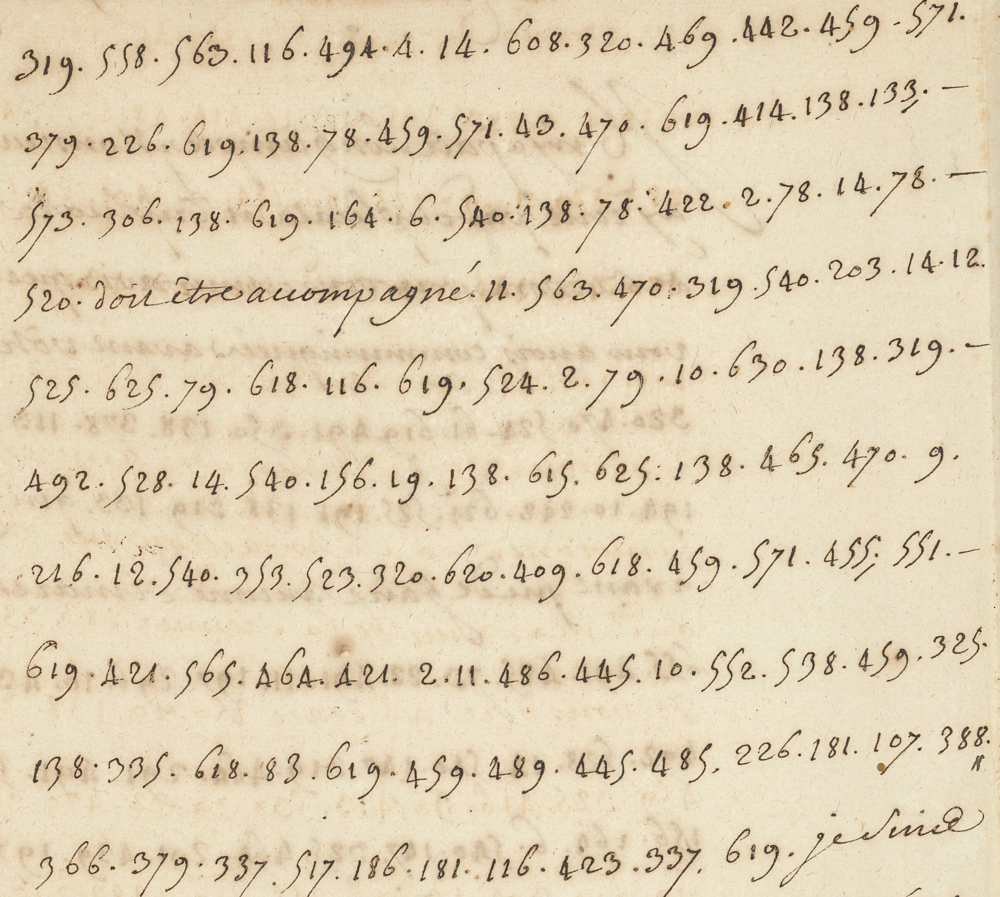
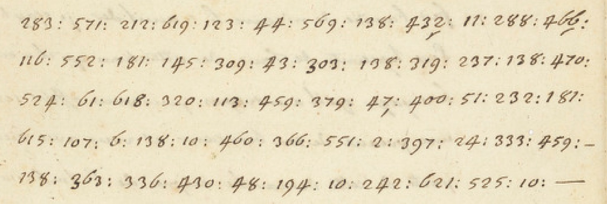

# Français 22225: excerpt

George Lasry, report PDF `05_francais-22225.pdf`, "Excerpt and Translation".

## Excerpt 1 (f145v — beginning of the excerpt f146r — cipher continuation and cleartext)

**J’ay fait icy le plu[s] de caresses que j’ay pu à Kerim Bey ; & quoique je n’aye pu avoir avec luy aucune conférence, j’ay lieu d’estre content des disposition favorables qu’il a fait paroître pour notre nation au personnes qui ont été luy parler de ma part.** Il faut continuer de cultiver son amitié et luy témoigner la satisfaction que j’ay des marques qu’il m’a donné de la sienne.

## Excerpt 2 (f145v)

**l’avenir un consul à Ispahan. Le raport que vous nous faires de ce que vous aures pu decourvrir des disposition de ce prince à ce sujet** doit estre accompagné **d’un[e] relation exacte & circonstanciee de la situation des affaires de Perse & de quelques refflection mesme sur le tour que vous pouves prévoir qu’elle prendront, pour eviter que les demarches que [le] Roy pourroit faire en cette occasion ne nous missent en conpromis**

## Excerpt 3 (f143v — five completecipherlines)

**Je vous fis conn[oistre] avant votre depart d’icy qu’il conviendroit au intérêt de la France de retablir le commerce que nous avions autrefois en Perse. Cette idée, qui ne venoit allors que de moy, me paroît avoir esté goutée.**
