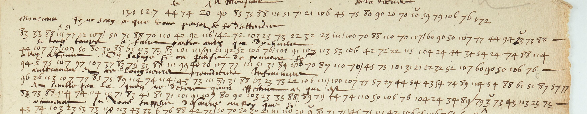

# Dupuy 61 — Villeroy, f258r: excerpt

George Lasry, report PDF `19_dupuy-61-villeroy-f258r.pdf`, "Excerpt and Translation".

## Excerpt 1 (f258r)

**Monsieur, je ne sçay ce que vous pensez faire d’attendre si long temps à faire partir ceux qu**[i] **doivent aller à Rome. On s’abuze si on pense de pouvoir faire autrement, et ces longueurs prejudicient infiniment, et semble par là qu’on ne desire qu’on effectue […]**
