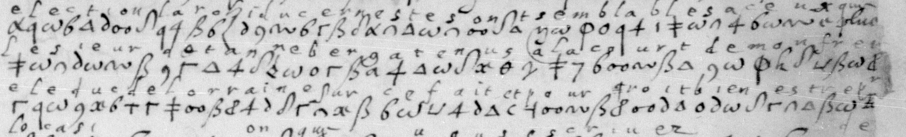

# Français 3318: excerpt

George Lasry, report PDF `23_francais-3318.pdf`, "Excerpt and Translation".

## Excerpt 1 (f32r, complete cipher lines 13–15)

…**election l'archiduc Erneste, sont semblables a ceu? que le sieur de Tanneberg a tenuz a la court de mon frere le duc de Lorraine sur ce fait et pourroit bien estre ?**
